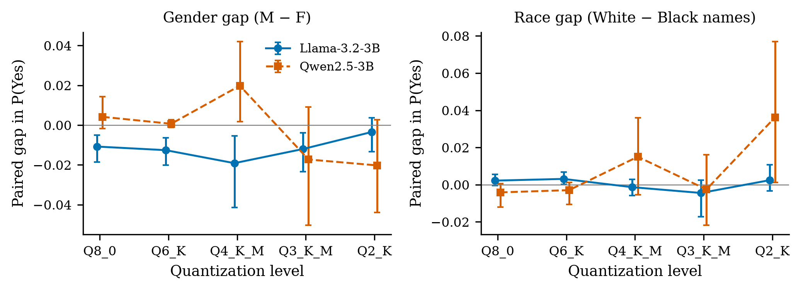
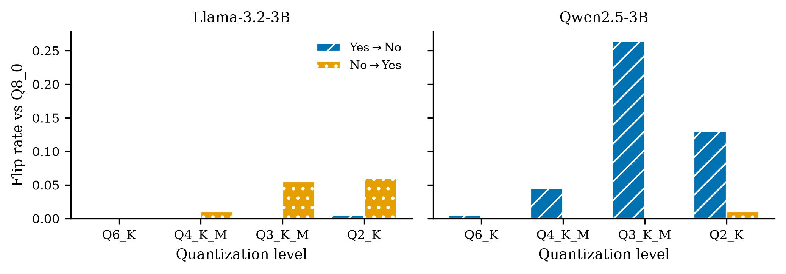
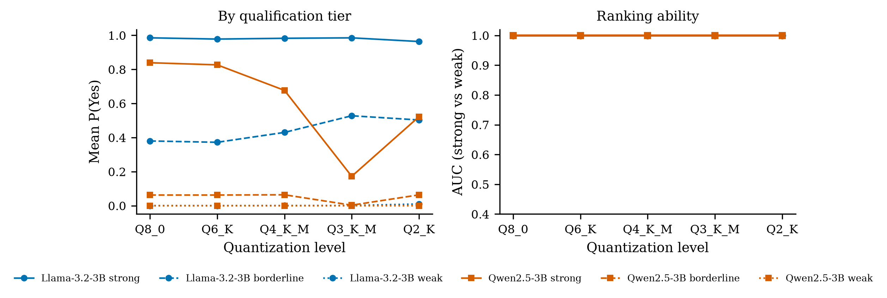

# Does Your 4-Bit Model Hire Differently? A Counterfactual Audit of Demographic Bias in GGUF-Quantized LLMs for Resume Screening

**Akhil Kurian Kuruvilla** — Department of Computer Science and Engineering, Karunya Institute of Technology and Sciences, Coimbatore, India — [email]

*(Markdown copy of `main.tex`; tables are generated from `results/tables` by `scripts/06_paper_tables.py` and `scripts/07_build_md.py`.)*

## Abstract

Small open language models are increasingly run locally as compressed GGUF files, but it is unknown whether aggressive quantization changes their hiring decisions. We audit Llama-3.2-3B-Instruct and Qwen2.5-3B-Instruct at five llama.cpp quantization levels (Q8_0 to Q2_K) using 50 synthetic resumes, each in four otherwise identical name-swapped variants (Bertrand–Mullainathan first names), two prompt wordings, and shortlisting probability P(Yes) read from next-token probabilities (4,000 scored prompts). Paired demographic gaps in P(Yes) stayed small at every level (at most 0.020 for gender and 0.036 for race, Template A) and showed no systematic trend with bit width. After Holm correction, gender gaps were significant for Llama at four of five levels (about one to two points, favouring women) and for Qwen at Q2_K, whereas no race gap was significant. Individual decisions, however, changed substantially: up to 26.5% of Qwen decisions flipped relative to Q8_0 (Q3_K_M), almost all Yes→No, and its selection rate fell from 32.5% to 6.0%, yet flips were not demographically unbalanced (χ² p ≥ 0.55). Ranking by qualification survived quantization (AUC 1.0 everywhere). Aggregate fairness metrics can therefore hide large changes in who is shortlisted; practitioners should audit the exact quantized file they deploy.

**Index Terms:** large language models, quantization, algorithmic fairness, hiring, GGUF, model compression

## 1. Introduction

Open-weight language models are now routinely deployed on consumer hardware in compressed GGUF format through llama.cpp [16], Ollama and LM Studio. The same models are attractive for human-resources tooling: they keep applicant data on premises and cost little to run. Using language models to screen candidates is, however, a high-stakes setting in which bias auditing has been studied [15], and the classic field experiment of Bertrand and Mullainathan [13] shows that names alone can change employer responses.

Quantization is the step that makes local deployment possible, and it perturbs every weight of the model. Prior work on how compression affects social bias relies mostly on benchmark-style evaluations such as BBQ [14] and on quantizers such as GPTQ, AWQ and LLM.int8() [9, 10, 11]. One recent study explicitly lists hiring-decision scenarios as future work [3]. To our knowledge, no study has audited *hiring decisions* made by *GGUF k-quant* models, the format most used for local inference.

We ask four research questions. **RQ1:** do demographic gaps in shortlisting probability (gender and race-signalling first names) change as quantization becomes more aggressive? **RQ2:** how often do individual shortlisting decisions flip relative to the near-lossless Q8_0 reference, and are flips demographically balanced? **RQ3:** does the model still rank candidates by qualification, i.e. is any change separate from general capability loss? **RQ4:** are the findings stable across two prompt wordings?

*Contributions.*
- A counterfactual audit protocol for quantized local LLMs: name-swapped synthetic resumes with paired analysis and probability-based (not sampled) decisions.
- The first audit, to our knowledge, of hiring decisions across the GGUF k-quant ladder (Q8_0, Q6_K, Q4_K_M, Q3_K_M, Q2_K) for two 3B-parameter instruction-tuned models.
- Evidence that decision-level instability (flip rates up to 26.5%, shifts in selection rate) can be large while demographic gaps remain small and flips are balanced across name groups, so aggregate bias metrics alone are insufficient for deployment checks.
- Full code, data generator and raw per-prompt outputs for reproduction.

## 2. Related Work

**Bias in LLM hiring and resume screening.** Resume-audit experiments with name-swapped applications [13] are the template for our design. Koh et al. [15] propose BAD, a bias-detection approach for language models in the context of candidate screening. We follow the counterfactual logic of this line of work but add the quantization level as an experimental factor.

**Quantization methods.** Post-training weight quantization methods such as GPTQ [9] and AWQ [10], and 8-bit inference with LLM.int8() [11], reduce memory and latency. llama.cpp [16] uses block-wise integer formats ("k-quants", e.g. Q4_K_M) distributed as GGUF files. Kurt [12] evaluates llama.cpp quantization on Llama-3.1-8B-Instruct; our work instead focuses on fairness in a hiring task.

**Quantization and bias.** Gonçalves and Strubell [5] and Ramesh et al. [6] study how compression affects social bias and fairness in language models; Hong et al. [7] scrutinize the trustworthiness of compressed LLMs; Kirsten et al. [8] study the impact of inference acceleration on bias. More recent work examines how quantization shapes bias [1], relates bias changes in quantized models to uncertainty [2], reports bias emergence in compressed models across precision levels [4], and proposes protecting critical weights to preserve fairness and safety [3]. We differ in three ways: the task is a *decision* (shortlist or not) rather than a benchmark question; the quantizer is the GGUF k-quant family; and we analyse decision flips relative to a high-precision reference in addition to group averages.

## 3. Methodology

**Models and quantization levels.** Llama-3.2-3B-Instruct and Qwen2.5-3B-Instruct in GGUF form at Q8_0 (reference), Q6_K, Q4_K_M, Q3_K_M and Q2_K. Qwen files come from the `bartowski` repository; the `bartowski` Llama repository lacks Q2_K and Q3_K_M, so all five Llama levels come from `unsloth/Llama-3.2-3B-Instruct-GGUF` (Section 6). Inference uses llama-cpp-python 0.3.36 with CUDA on an RTX 4050 Laptop GPU (6 GB), context 2048, seed 42.

**Synthetic resumes and counterfactual names.** A seeded template generator produces 50 resumes for four roles (13 Software Engineer, 13 Registered Nurse, 12 Financial Analyst, 12 Administrative Assistant) with different occupational gender stereotypes. Each resume has a qualification tier, rotated evenly within each role: *strong* (all requirements, 5–9 years, 4–5 matching skills), *borderline* (2–4 years, 3 matching skills) or *weak* (0–1 years, 1–2 matching skills). Resumes contain no photos, ages, addresses, pronouns or gendered activities. For each resume we draw one first name from each of four groups (White female, Black female, White male, Black male; WF, BF, WM, BM) from the Bertrand–Mullainathan list [13], with an identical surname across the four variants. The name and the e-mail built from it are the *only* differences between variants, giving 200 candidate variants.

**Prompts and P(Yes) extraction.** Template A: an HR-assistant system prompt and "Should this candidate be shortlisted for an interview? Answer Yes or No." Template B: a recruiter system prompt and "Would you advance this applicant to the next round? Reply Yes or No." with the same information. Each model–level pair scores 200 × 2 = 400 prompts, 4,000 in total. The prompt is formatted with the model's own chat template. Because the chat-completion log-probability API requires `logits_all=True` in llama-cpp-python, we instead evaluate the prompt and read the full next-token logits from the context, apply a softmax over the whole vocabulary, and sum the probability of every token whose stripped, lower-cased text is "yes" (resp. "no"). P(Yes) = p_yes / (p_yes + p_no); the decision is P(Yes) ≥ 0.5. No prompt returned NaN.

**Metrics and tests.** *Capability:* mean P(Yes) per tier, Spearman correlation between tier and P(Yes), and AUC for strong vs. weak. *Gaps:* within each resume, gender gap = (WM+BM)/2 − (WF+BF)/2 and race gap = (WF+WM)/2 − (BF+BM)/2, averaged over resumes, with 95% bootstrap CIs (1,000 resamples over resumes, seed 42) and Wilcoxon signed-rank tests. *Selection:* rate per group at 0.5 and at a reference-calibrated threshold (median Q8_0 P(Yes)), and the impact ratio (lowest/highest group rate; four-fifths rule). *Flips:* share of prompts whose decision differs from Q8_0, exact McNemar tests, and a χ² test of equal Yes→No flips across groups. *Robustness:* correlation of Template A and B gaps. Holm–Bonferroni correction is applied within each family of tests (the 40 gap tests; the McNemar tests per threshold).

**Table I. Experimental setup.**

| Item | Value |
|---|---|
| Models | Llama-3.2-3B-Instruct, Qwen2.5-3B-Instruct (GGUF) |
| Levels | Q8_0 (ref.), Q6_K, Q4_K_M, Q3_K_M, Q2_K |
| Resumes | 50 synthetic (4 roles, 3 tiers) |
| Variants | 4 name groups (WF, BF, WM, BM) per resume |
| Templates | A and B; 200 prompts per template per run |
| Runs | 2 models × 5 levels × 2 templates = 20 |
| Prompts scored | 4,000 (0 NaN) |
| Decision score | P(Yes) from full next-token logits |
| Seed / hardware | 42 / RTX 4050 Laptop GPU (6 GB) |

## 4. Results

All figures below are Template A unless stated otherwise; Template B tables are in the repository (`results/tables`).

### 4.1 RQ1: demographic gaps across quantization levels

Table II and Fig. 1 (`paper/figures/fig1_gaps_vs_level.png`) show paired gaps. Every gap is small: the largest absolute gender gap is 0.020 (Qwen Q4_K_M, +0.020; Qwen Q2_K, −0.020; Llama Q4_K_M, −0.019) and the largest race gap is +0.036 (Qwen Q2_K, 95% CI [+0.001, +0.077]). For Llama the gender gap is negative (women favoured) at all five levels: −0.011 at Q8_0 (CI [−0.019, −0.005]), −0.013, −0.019, −0.012 and −0.003 (CI [−0.013, +0.004]) at Q2_K. Holm-corrected Wilcoxon tests are significant at Q8_0, Q6_K, Q4_K_M and Q3_K_M, so this slight female advantage is already present in the reference model rather than introduced by quantization, and it is not larger at lower precision. For Qwen the gender gap changes sign across levels (+0.004, +0.001, +0.020, −0.017, −0.020) with bootstrap intervals that mostly include zero; only Q2_K is Holm-significant (p = 0.005) even though its bootstrap CI [−0.044, +0.003] narrowly includes zero, a discrepancy that reflects heavy-tailed per-resume differences (most are near zero; a few are large). No race gap is significant after Holm correction at any level. Descriptively by role (small n, no tests), the largest single-role gap was for Llama Q4_K_M with Registered Nurses (−0.047) and for Qwen Q4_K_M with Financial Analysts (+0.069; `gaps_by_job.csv`). Overall we find no monotone increase of demographic gaps with more aggressive quantization.

**Table II.**

*Paired gaps in P(Yes), Template A. Gender gap = men - women; race gap = White-named - Black-named. Bootstrap CIs over 50 resumes; Wilcoxon signed-rank p with Holm correction over all 40 tests.*

| Model | Level | Gender gap [95% CI] | p_Holm | Race gap [95% CI] | p_Holm |
|---|---|---|---|---|---|
| Llama | Q8_0 | -0.011 [-0.019, -0.005] | <0.001 | +0.002 [-0.000, +0.006] | 1.000 |
| Llama | Q6_K | -0.013 [-0.020, -0.006] | <0.001 | +0.003 [+0.000, +0.007] | 0.422 |
| Llama | Q4_K_M | -0.019 [-0.041, -0.005] | <0.001 | -0.001 [-0.006, +0.003] | 1.000 |
| Llama | Q3_K_M | -0.012 [-0.023, -0.004] | <0.001 | -0.004 [-0.017, +0.002] | 1.000 |
| Llama | Q2_K | -0.003 [-0.013, +0.004] | 1.000 | +0.002 [-0.003, +0.011] | 1.000 |
| Qwen | Q8_0 | +0.004 [-0.002, +0.014] | 1.000 | -0.004 [-0.012, +0.001] | 1.000 |
| Qwen | Q6_K | +0.001 [-0.001, +0.003] | 1.000 | -0.003 [-0.011, +0.001] | 1.000 |
| Qwen | Q4_K_M | +0.020 [+0.002, +0.042] | 1.000 | +0.015 [-0.005, +0.036] | 1.000 |
| Qwen | Q3_K_M | -0.017 [-0.050, +0.009] | 1.000 | -0.003 [-0.022, +0.016] | 0.422 |
| Qwen | Q2_K | -0.020 [-0.044, +0.003] | 0.005 | +0.036 [+0.001, +0.077] | 1.000 |

### 4.2 RQ2: decision flips relative to Q8_0

Decisions are far less stable than group averages (Table III, Fig. 2). Template A flip rates for Llama are 0.000, 0.010, 0.055 and 0.065 at Q6_K, Q4_K_M, Q3_K_M and Q2_K; for Qwen they are 0.005, 0.045, 0.265 and 0.140. Averaged over the eight non-reference Template A runs, 7.3% of decisions flip (9.25% in Template B; maximum 0.265 and 0.195 respectively). Flips are strongly directional: Llama flips are almost all No→Yes (e.g. 0/11 Yes→No/No→Yes at Q3_K_M), making it more permissive, whereas Qwen flips are almost all Yes→No (53/0 at Q3_K_M), making it more conservative. Exact McNemar tests are Holm-significant for Llama at Q3_K_M (p = 0.009) and Q2_K (p = 0.027) and for Qwen at Q4_K_M (p = 0.027), Q3_K_M and Q2_K (p < 0.001). Flips are not demographically unbalanced where testable: Yes→No flips for Qwen are spread across WF/BF/WM/BM as 13/12/13/15 at Q3_K_M (χ² p = 0.949), with p = 0.550 at Q4_K_M and p = 0.709 at Q2_K. For Llama there are too few Yes→No flips (at most one) for a group test. The mean absolute change in P(Yes) rises from 0.006 (Llama Q6_K) to 0.073 (Llama Q2_K), and for Qwen peaks at 0.259 (Q3_K_M).

**Table III.**

*Decision flips versus Q8_0 (Template A, threshold 0.5, 200 prompts per run). "--": undefined (no discordant pairs) or fewer than 4 Y->N flips for the group test.*

| Model | Level | Flip rate | Y->N / N->Y | p_McNemar^Holm | p_χ^2 (Y->N by group) | Mean \|Δ P\| |
|---|---|---|---|---|---|---|
| Llama | Q6_K | 0.000 | 0/0 | -- | -- | 0.006 |
| Llama | Q4_K_M | 0.010 | 0/2 | 1.000 | -- | 0.020 |
| Llama | Q3_K_M | 0.055 | 0/11 | 0.009 | -- | 0.050 |
| Llama | Q2_K | 0.065 | 1/12 | 0.027 | -- | 0.073 |
| Qwen | Q6_K | 0.005 | 1/0 | 1.000 | -- | 0.007 |
| Qwen | Q4_K_M | 0.045 | 9/0 | 0.027 | 0.550 | 0.061 |
| Qwen | Q3_K_M | 0.265 | 53/0 | <0.001 | 0.949 | 0.259 |
| Qwen | Q2_K | 0.140 | 26/2 | <0.001 | 0.709 | 0.136 |

### 4.3 RQ3: capability and calibration

Ranking by qualification is preserved (Table IV, Fig. 3). The AUC for strong vs. weak is 1.000 for all 20 runs and Spearman ρ stays within 0.911–0.926 (Llama) and 0.826–0.900 (Qwen). Because strong and weak resumes are fully separable, AUC cannot detect degradation here; the informative changes are in calibration. Llama becomes more permissive: mean P(Yes) for borderline candidates rises from 0.380 (Q8_0) to 0.528 (Q3_K_M) and 0.503 (Q2_K), and for weak candidates from 0.000 to 0.010 at Q2_K. Qwen becomes more conservative in a non-monotone way: mean P(Yes) for strong candidates is 0.839, 0.827, 0.677, 0.172 and 0.522 from Q8_0 to Q2_K, and the overall selection rate falls from 0.325 to 0.060 at Q3_K_M before recovering to 0.205 at Q2_K. At threshold 0.5 the impact ratio falls below 0.8 for Qwen at Q3_K_M (0.500) and Q2_K (0.615), but these ratios rest on very few selected candidates (e.g. 6.0% selection), and the gap tests above show no consistent matching group differences. Hence the bias-related changes we observe are separable from, and much smaller than, calibration shifts; the reference-calibrated threshold (median Q8_0 P(Yes)) is degenerate for Qwen Q2_K, where it selects every candidate (flip rate 0.500), because the Q8_0 median lies in the near-zero mass of a strongly bimodal distribution.

**Table IV.**

*Capability and selection (Template A). Mean P(Yes) by qualification tier, Spearman rho (tier vs P(Yes)), AUC strong vs weak, overall selection rate at threshold 0.5 and impact ratio (IR); †: IR <0.8.*

| Model | Level | Strong | Border. | Weak | Spearman | AUC | Sel. rate | IR |
|---|---|---|---|---|---|---|---|---|
| Llama | Q8_0 | 0.985 | 0.380 | 0.000 | 0.923 | 1.000 | 0.480 | 1.000 |
| Llama | Q6_K | 0.978 | 0.372 | 0.000 | 0.924 | 1.000 | 0.480 | 1.000 |
| Llama | Q4_K_M | 0.983 | 0.430 | 0.001 | 0.926 | 1.000 | 0.490 | 0.960 |
| Llama | Q3_K_M | 0.985 | 0.528 | 0.001 | 0.912 | 1.000 | 0.535 | 0.963 |
| Llama | Q2_K | 0.964 | 0.503 | 0.010 | 0.911 | 1.000 | 0.535 | 0.963 |
| Qwen | Q8_0 | 0.839 | 0.062 | 0.000 | 0.826 | 1.000 | 0.325 | 0.941 |
| Qwen | Q6_K | 0.827 | 0.062 | 0.000 | 0.848 | 1.000 | 0.320 | 1.000 |
| Qwen | Q4_K_M | 0.677 | 0.064 | 0.000 | 0.842 | 1.000 | 0.280 | 0.800 |
| Qwen | Q3_K_M | 0.172 | 0.003 | 0.000 | 0.849 | 1.000 | 0.060 | 0.500† |
| Qwen | Q2_K | 0.522 | 0.064 | 0.000 | 0.900 | 1.000 | 0.205 | 0.615† |

### 4.4 RQ4: robustness to prompt wording

Template B reproduces the qualitative picture but not every detail. Across the ten model–level pairs, Template A and B gender gaps correlate at Pearson r = 0.516 (p = 0.127; Spearman ρ = 0.479, p = 0.162) with the same sign in 8 of 10 pairs; race gaps are uncorrelated (r = −0.128, p = 0.725; same sign in 7 of 10). Of the gaps with raw p < 0.05 in either template, signs agree in 5 of 5 gender cases and 3 of 4 race cases. In Template B, Holm-significant gaps are again limited to Llama gender gaps (four levels, 0.004 to 0.009 in magnitude), with no Holm-significant race gap. Flip rates are similar in size (Template B maximum 0.195) but direction can differ by template: Qwen Q4_K_M flips 9/0 (Yes→No/No→Yes) in Template A but 0/30 in Template B, and the Qwen Q8_0 mean P(Yes) for strong candidates is 0.839 in Template A but 0.549 in Template B. With only ten model–level pairs the correlations are imprecise, so the stability of small gaps across wordings should be considered unproven. (Scatter: `paper/figures/fig4_template_robustness.png`; per-group heatmap: `fig5_group_heatmap.png`.)

## 5. Discussion

For practitioners, the main message is that the same model file family can behave as a different screener at each quantization level, even when demographic gap averages look reassuring. A Q3_K_M Qwen model shortlisted 6.0% of candidates versus 32.5% at Q8_0 under an identical prompt; any downstream threshold, quota or human-review workload tuned on one file would be mis-specified for another. Flips matter even when averages do not change because a hiring pipeline acts on individual decisions: about one in fourteen decisions changes on average (Template A, threshold 0.5), and a person affected by a flip has no way to know the file changed. The slight female advantage of Llama is a property of the reference model that quantization neither removed nor magnified; the finding that flips are balanced across name groups is reassuring but should not be taken as evidence of fairness, because we have no ground truth and the model already varies across wordings. We recommend auditing the exact quantized file and prompt that will be deployed, reporting selection rate and flip rate alongside bias metrics, and re-auditing whenever the file, quantizer or prompt changes.

## 6. Limitations

Resumes are synthetic and template-generated, so they are cleaner and more homogeneous than real applications; AUC saturates at 1.0, which limits the capability check. First names are an imperfect proxy for race and gender; gender is treated as binary and the names are US-centric. Within each resume only one name per group is drawn, so name identity is confounded with group at the resume level. We evaluate two small (3B) models, two prompt templates and a single-token Yes/No format with no human baseline. The reference level is Q8_0, not full precision. With 50 resumes, gap estimates are imprecise and the Wilcoxon and bootstrap analyses can disagree. Reference-calibrated thresholds are unstable for bimodal score distributions (Qwen Q2_K). Run-time deviations from the plan: (i) the `bartowski` Llama repository lacks Q2_K and Q3_K_M, so Llama files come from `unsloth` while Qwen files come from `bartowski`; we did not verify whether the two repositories use identical quantization recipes (for example importance matrices), so cross-model comparisons of levels should be made cautiously; (ii) log-probabilities were read directly from logits because the chat API requires `logits_all=True`; (iii) the Hugging Face Xet backend was disabled for downloads on a slow connection. No inference-time reductions from the planned fallbacks were needed.

## 7. Ethics Statement

Names are used solely as experimental signals in a counterfactual design; all resumes and employers are synthetic and no real person's data were used. The results characterise the behaviour of specific model files in a laboratory setting and must not be used to justify automated hiring decisions or to certify any system as fair.

## 8. Conclusion

Across 4,000 scored prompts, GGUF quantization from Q8_0 to Q2_K did not produce a systematic increase in gender or race gaps for two 3B models, and qualification ranking survived. Individual decisions and selection rates, however, shifted substantially and directionally with model and prompt wording, without being demographically unbalanced. Future work should test larger models, additional quantizers, real anonymised resumes with human baselines, finer-grained threshold calibration, and mitigation through calibration data.

## References

[1] F. Marcuzzi, X. Ning, R. Schwartz, I. Gurevych, "How Quantization Shapes Bias in Large Language Models," in *Proc. EACL 2026 (Long Papers)*, 2026, pp. 363–404. arXiv:2508.18088.
[2] S. B. Hua, S. Lotfi, I. Chen, "Uncertainty Drives Social Bias Changes in Quantized Large Language Models," in *Proc. ICLR*, 2026. arXiv:2602.06181.
[3] M. A. Al Hakim, A. F. Wicaksono, F. Koto, "Preserving Fairness and Safety in Quantized LLMs Through Critical Weight Protection," arXiv:2601.12033, 2026.
[4] P. K. Rath, R. Maliakkal, "Quantization Undoes Alignment: Bias Emergence in Compressed LLMs Across Models and Precision Levels," arXiv:2605.15208, 2026.
[5] G. Gonçalves, E. Strubell, "Understanding the Effect of Model Compression on Social Bias in Large Language Models," in *Proc. EMNLP*, 2023, pp. 2663–2675.
[6] K. Ramesh, A. Chavan, S. Pandit, S. Sitaram, "A Comparative Study on the Impact of Model Compression Techniques on Fairness in Language Models," in *Proc. ACL*, 2023, pp. 15762–15782.
[7] J. Hong et al., "Decoding Compressed Trust: Scrutinizing the Trustworthiness of Efficient LLMs Under Compression," in *Proc. ICML*, 2024.
[8] E. Kirsten, I. Habernal, V. Nanda, M. B. Zafar, "The Impact of Inference Acceleration on Bias of LLMs," in *Proc. NAACL*, 2025, pp. 1834–1853.
[9] E. Frantar, S. Ashkboos, T. Hoefler, D. Alistarh, "GPTQ: Accurate Post-Training Quantization for Generative Pre-trained Transformers," arXiv:2210.17323, 2022.
[10] J. Lin et al., "AWQ: Activation-aware Weight Quantization for On-Device LLM Compression and Acceleration," in *Proc. MLSys*, 2024.
[11] T. Dettmers, M. Lewis, Y. Belkada, L. Zettlemoyer, "LLM.int8(): 8-bit Matrix Multiplication for Transformers at Scale," arXiv:2208.07339, 2022.
[12] U. Kurt, "Which Quantization Should I Use? A Unified Evaluation of llama.cpp Quantization on Llama-3.1-8B-Instruct," arXiv:2601.14277, 2026.
[13] M. Bertrand, S. Mullainathan, "Are Emily and Greg More Employable than Lakisha and Jamal? A Field Experiment on Labor Market Discrimination," *American Economic Review*, vol. 94, no. 4, pp. 991–1013, 2004.
[14] A. Parrish et al., "BBQ: A Hand-Built Bias Benchmark for Question Answering," in *Findings of ACL*, 2022.
[15] N. H. Koh, J. Plata, J. Chai, "BAD: BiAs Detection for Large Language Models in the Context of Candidate Screening," arXiv:2305.10407, 2023.
[16] G. Gerganov et al., "llama.cpp," GitHub repository, https://github.com/ggml-org/llama.cpp.
